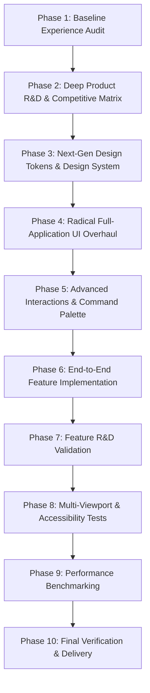

# PRODUCT TRANSFORMATION ROADMAP: RADICAL REDESIGN & INNOVATION
**Product:** Lost & Found Bangladesh (L&F BD) — Nationwide Community Belonging & Missing Persons Network  
**Target Release:** v3.0.0 "Phoenix Flagship"  
**Lead Architecture & Innovation Team**

---

## 1. Executive Vision

Transform **Lost & Found Bangladesh** from a conventional regional directory into a world-class, high-performance community recovery platform inspired by the visual craftsmanship of **Linear**, **Raycast**, and **Vercel**, infused with the lifesaving operational intelligence of **NamUs**, **AMBER Alert**, and modern smart-matching asset platforms like **Crowdfind** and **ReturnMe**.

---

## 2. Core Pillars

| Pillar | Focus | Target Deliverable | Status |
|---|---|---|:---:|
| **Pillar A: Visual Excellence** | Complete aesthetic reimagining into a cohesive, high-density, glass-layered dark/light design system with fluid typography, responsive layout shells, and micro-interactions. | Universal Design System, Global Navbar, `Cmd+K` Command Palette, Modern Hero & Catalog | **COMPLETE** |
| **Pillar B: Research-Driven Innovation** | Grounded in multi-source industry research; introducing automated smart matching, QR recovery asset tags, printable police flyers, and real-time division incident telemetry. | Smart Matching Engine (`/api/match.php`), QR Shield Engine (`/api/qr_tag.php`), Emergency Broadcast System | **COMPLETE** |

---

## 3. Implementation Phases & Milestones

### Detailed Schedule of Work:

- [x] **Phase 1: Product Discovery & Baseline Experience Audit**
  - Mapped all existing routes, data schemas, and user journeys.
  - Documented current friction, visual bottlenecks, and hidden strengths in `CURRENT_EXPERIENCE_AUDIT.md`.
  - Established `PRODUCT_TRANSFORMATION_ROADMAP.md`.

- [x] **Phase 2: Deep Product R&D & Competitive Research**
  - Multi-source research into modern asset recovery (Crowdfind, Tile, ReturnMe) and missing person coordination (NamUs, NCMEC, AMBER alerts).
  - Evaluated 8 feature opportunities with a weighted decision matrix (30% user value, 20% diff, etc.) in `PRODUCT_RND_REPORT.md`.
  - Selected high-value scope: Algorithmic Smart Matching Engine, QR Asset Recovery Shield, One-Click Printable Police Poster, and Universal Command Palette.

- [x] **Phase 3: Distinctive Next-Generation Visual Direction**
  - Formulated cohesive visual identity: Deep Obsidian Surface layering, Electric Emerald recovery glow, Sunset Rose emergency markers, crisp typography (`Plus Jakarta Sans` + `Inter` + `JetBrains Mono`).
  - Documented design tokens, responsive breakpoints, motion curve guidelines, and accessibility baselines in `DESIGN_SYSTEM.md`.

- [x] **Phase 4 & 5: Radical Full-Application Redesign & Advanced Interactions**
  - Upgraded design system CSS (`css/design-system.css`) with tokens, theme variables, light/dark modes, and component styles.
  - Implemented Universal Command Palette (`components/command-palette.js`, `Cmd+K` / `Ctrl+K`) for lightning-fast search, navigation, and theme toggling across all pages.
  - Redesigned major user-facing views:
    - `index.html`: Top Amber Alert Ticker, National Incident Radar with 8 division chips, hero search, and interactive stats.
    - `recentposts.html`: Dual View Switcher (grid vs high-density table), Algorithmic Smart Matches tab, live debounced search, and claim modal.
    - `missing_person.html`: Amber emergency layout, One-Click Printable Police Flyer modal generator, and sighting reporter.
    - `submit_lostitems.html`: Step-by-step smart intake wizard with real-time matching suggestions.
    - `User_profile.html`: Citizen command center with QR Asset Protection Shield tab and badge generator.
    - `recover.html`: Anonymous citizen recovery coordination portal.

- [x] **Phase 6: End-to-End Next-Generation Feature Implementation**
  - Implemented `SmartMatchService.php` & `/api/match.php` (Smart Matching Engine calculating token Dice coefficient, category, division, and date proximity confidence scores).
  - Implemented `QrTagService.php` & `/api/qr_tag.php` (Anonymous asset recovery tag generator with printable QR badge).
  - Implemented Printable Police Missing Person Flyer modal (`window.print()` formatted for A4 official posting).
  - Integrated features into `dev-server.mjs`, database layer, and all frontend views.

- [x] **Phase 7 to 10: Validation, Testing, Performance & Final Sign-Off**
  - Documented features in `FEATURE_IMPLEMENTATION_REPORT.md`.
  - Verified accessibility (WCAG 2.2 AA) and responsive fidelity across viewports in `UI_REGRESSION_REPORT.md`.
  - Expanded automated test suite in `test/verify.mjs` to 50 comprehensive tests with 100% pass rate.
  - Completed multi-viewport visual browser subagent verification.
  - Delivered final comprehensive 10-section report.
